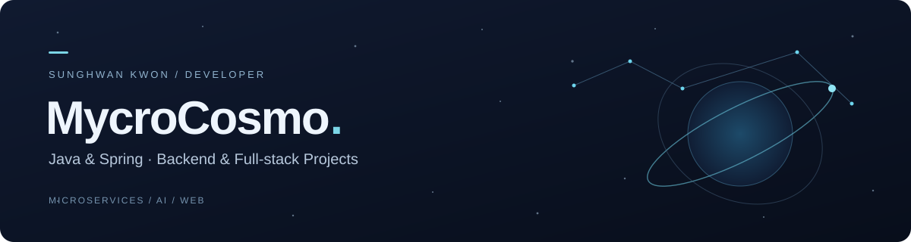
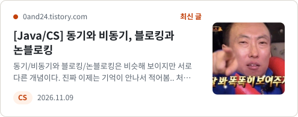

  

  <strong>안녕하세요, 권성환입니다.</strong> 
  반복 작업을 줄이는 개발 도구와 Java·Spring 기반 백엔드를 만듭니다.

  <a href="https://github.com/MycroCosmo?tab=repositories">Repositories</a> ·
  <a href="https://github.com/MycroCosmo/blackbox">Developer Tools</a> ·
  <a href="https://github.com/MycroCosmo/open-api-chat-project">AI Chatbot</a>

## About

- **Backend** — Java · Spring Boot · Spring Framework
- **Developer Tools** — MyBatis 반복 CRUD 자동화 · AI 코딩 에이전트 장애 기록
- **Architecture** — 조회 성능, 서비스 경계, 외부 저장소와 DB의 정합성

## Tech Stack

| 분야 | 프로젝트에서 사용한 기술 |
| :--- | :--- |
| Backend | Java · Spring Boot · Spring Security · Spring Data JPA · MyBatis |
| Web & Tooling | TypeScript · JavaScript · Node.js · JSP · Mustache |
| Data | PostgreSQL · Oracle Database |
| Services | Google Cloud Storage · Spring Cloud Gateway · Consul · Kafka · Spring AI |
| Build & Collaboration | Gradle · Maven · Git · GitHub |

## Blog

[0and24.tistory.com](https://0and24.tistory.com)에 개발하며 겪은 문제와 배운 것을 정리합니다.

<!-- TISTORY-CARD:START -->
<a href="https://0and24.tistory.com/80"><picture><source media="(prefers-color-scheme: dark)" srcset="https://raw.githubusercontent.com/MycroCosmo/MycroCosmo/main/assets/tistory/latest-dark.svg?v=6cbb4306"></picture></a>
<a href="https://0and24.tistory.com"><picture><source media="(prefers-color-scheme: dark)" srcset="https://raw.githubusercontent.com/MycroCosmo/MycroCosmo/main/assets/tistory/older-header-dark.svg?v=58ca7e2f"></picture></a> 
<a href="https://0and24.tistory.com/79"><picture><source media="(prefers-color-scheme: dark)" srcset="https://raw.githubusercontent.com/MycroCosmo/MycroCosmo/main/assets/tistory/older-1-dark.svg?v=155db4b7"></picture></a> 
<a href="https://0and24.tistory.com/78"><picture><source media="(prefers-color-scheme: dark)" srcset="https://raw.githubusercontent.com/MycroCosmo/MycroCosmo/main/assets/tistory/older-2-dark.svg?v=98b8af62"></picture></a> 
<a href="https://0and24.tistory.com/77"><picture><source media="(prefers-color-scheme: dark)" srcset="https://raw.githubusercontent.com/MycroCosmo/MycroCosmo/main/assets/tistory/older-3-dark.svg?v=ec10c433"></picture></a> 
<a href="https://0and24.tistory.com/76"><picture><source media="(prefers-color-scheme: dark)" srcset="https://raw.githubusercontent.com/MycroCosmo/MycroCosmo/main/assets/tistory/older-4-dark.svg?v=f80a9633"></picture></a> 
 
<!-- TISTORY-CARD:END -->

## Selected Projects

### 01 · [MyBatis Easy Sync Starter](https://github.com/MycroCosmo/mybatis-easy-sync-starter-public)

직접 작성한 SQL을 유지하면서 반복 CRUD 작성을 줄이는 Java 라이브러리입니다. 런타임 SQL 병합과 컴파일 시점 Mapper/XML 검증을 별도 모듈로 제공합니다.

`Java` `MyBatis` `Spring Boot` `Annotation Processing` `Gradle`

### 02 · [Photo Portfolio Backend](https://github.com/MycroCosmo/io-terraforming-back)

사진작가의 프로젝트와 이미지를 관리하는 Spring Boot API입니다. 팀 개발 이후 N+1 조회 문제, 쓰기 API 인가, GCS와 DB 사이의 보상 처리를 개인 리팩터링으로 개선했습니다.

`Java` `Spring Boot` `Spring Security` `JPA` `PostgreSQL` `Google Cloud Storage`

### 03 · [Dev Blackbox](https://github.com/MycroCosmo/blackbox)

AI 코딩 에이전트를 위한 로컬 실행 기록 도구입니다. 개발 명령과 네트워크 실패를 기록하고, 민감 정보를 가린 장애 보고서를 만들어 디버깅 근거를 남깁니다.

`TypeScript` `Node.js` `CLI` `Incident Reports`

### More Projects

[MSA Service](https://github.com/MycroCosmo/msa-service) · [Spring AI Chatbot](https://github.com/MycroCosmo/open-api-chat-project) · [ViewPort](https://github.com/MycroCosmo/mini_project_viewport)

